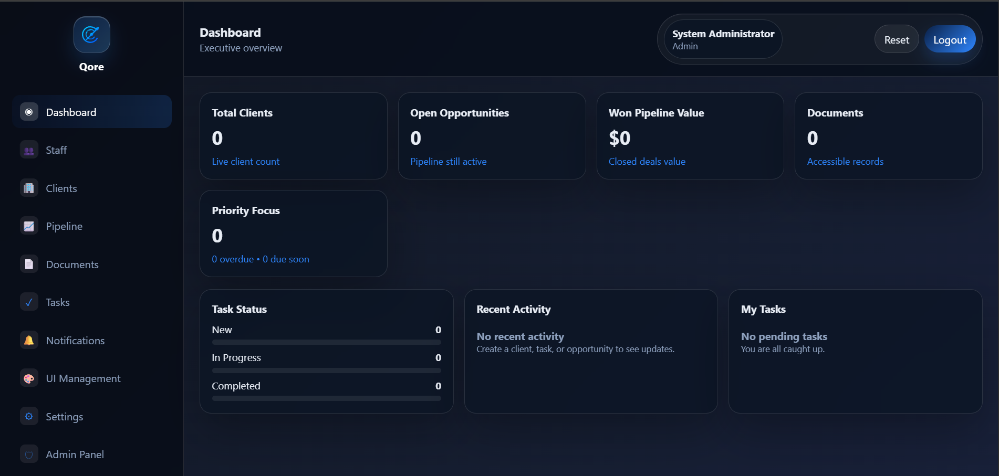
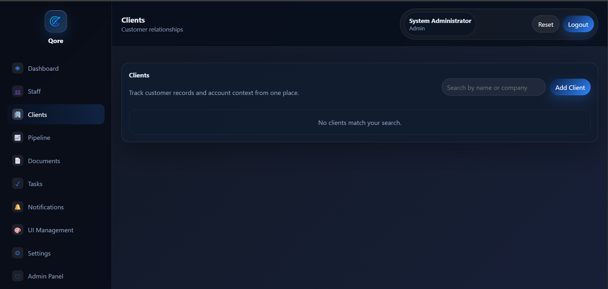
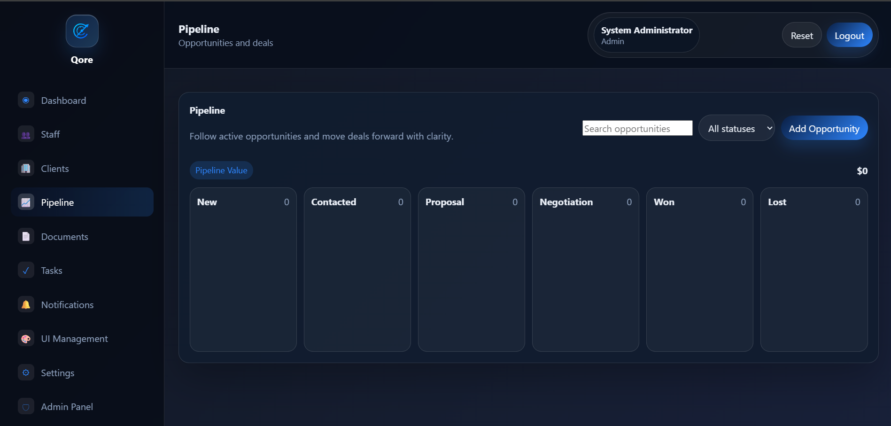
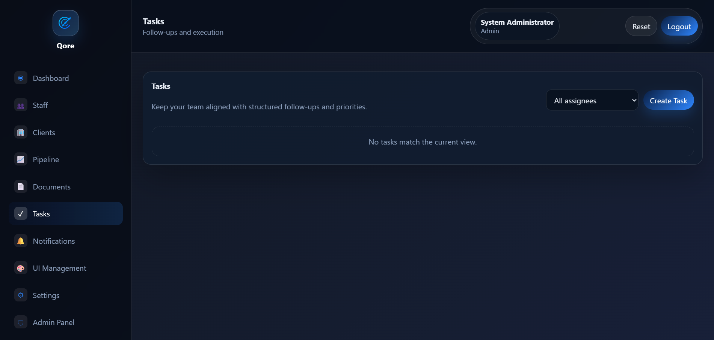
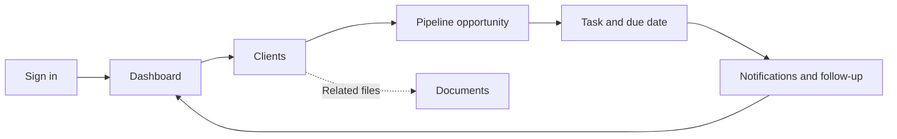
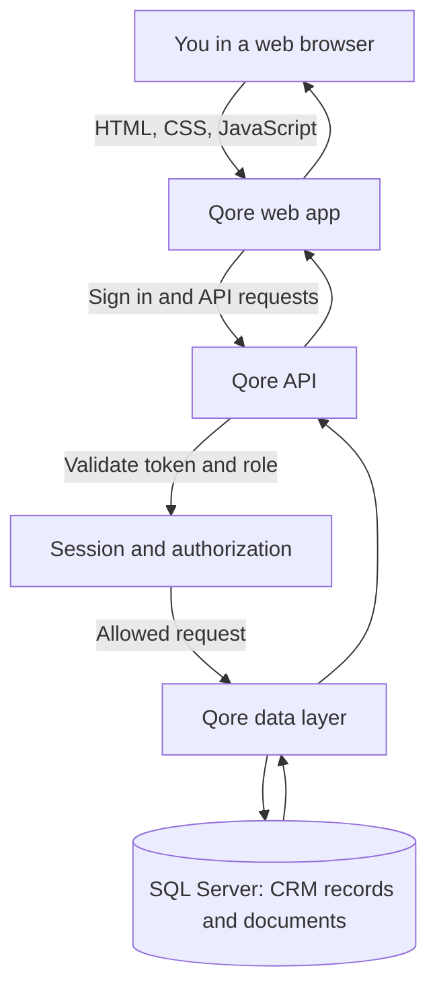

# Qore CRM

> A self-hosted workspace for customer relationships, sales opportunities, team tasks, and documents.

**One shared workspace** · **Role-based access** · **Six interface languages**

---

Qore brings day-to-day customer and sales work together. Use the dashboard to see what is happening, keep client records and opportunities organized, and make the next action clear with tasks and notifications.

## At a glance

| Area | What you can do |
| --- | --- |
| **Dashboard** | Review a summary of your workspace and get to key areas quickly. |
| **Staff** | View and manage team accounts according to your role. |
| **Clients** | Keep customer and company details in one place. |
| **Pipeline** | Track opportunities, their stages, and their value. |
| **Tasks** | Create work, set priorities and due dates, and follow progress. |
| **Documents** | Upload, find, and download team files. |
| **Notifications** | Check reminders and updates that need attention. |
| **UI Management** | Choose and manage the appearance of the workspace. |
| **Settings and Admin Panel** | Manage account preferences and administrator-only controls. |

### A visual tour

| Dashboard | Clients |
| --- | --- |
|  |  |
| **See the work at a glance** | **Keep client information organized** |

| Sales pipeline | Tasks |
| --- | --- |
|  |  |
| **Follow opportunities through the pipeline** | **Turn follow-ups into trackable tasks** |

## How to use Qore

Start with a client record, connect sales activity to an opportunity, and keep the next action visible as a task. Return to the dashboard and notifications to see what needs attention.



### Your first visit

1. Open the Qore address shared by your administrator and sign in with your account.
2. Select **Learning Guide** in the navigation for an in-app tour.
3. Use **Clients** to find or add a customer record.
4. Use **Pipeline** to create and update opportunities.
5. Add **Tasks** for follow-ups, then check **Notifications** and the **Dashboard** regularly.
6. Use **Documents** to keep relevant files available to your team.

Most create and edit actions open in a dialog, so you can work without leaving the current section. Available sections and actions depend on your account role. If you cannot sign in or cannot see a section you need, contact your Qore administrator; there is no shared demo account or default password.

### Make it yours

The interface supports **English, Russian, Armenian, Arabic, Chinese, and Korean**. Change the language and available appearance preferences in **Settings**. The app also includes theme management for authorized users.

## How the application works

The browser UI is served by the Qore web application. It calls the API for sign-in and workspace actions; the API checks the signed-in session and permissions before reading or changing SQL Server data.



The web UI is plain HTML, CSS, and JavaScript—there is no separate frontend build step. The .NET API serves the UI and provides the application endpoints. On startup, Qore applies database migrations; on a new database it creates the initial administrator from the configured credentials and adds the default theme.

## Install and run (Windows)

These steps run Qore locally for development or evaluation. For a shared or public deployment, use a secured SQL Server, HTTPS, and a managed secret store.

### Prerequisites

- **.NET 8 SDK**
- **SQL Server** (local SQL Server or SQL Server Express) reachable by the machine running Qore
- **Windows PowerShell**

The SQL Server account in the connection string must be allowed to connect and create or update the Qore database. The example uses Windows integrated authentication; change the server/instance and authentication options to match your SQL Server setup.

### 1. Configure and start

From the repository root, run the following in PowerShell. Update the connection string if your SQL Server is not at `localhost`. The password prompt is hidden; the initial administrator password must contain at least 12 characters.

```powershell
$env:ASPNETCORE_ENVIRONMENT = 'Development'
$env:ASPNETCORE_URLS = 'http://localhost:5000'
$env:ConnectionStrings__QoreDb = 'Server=localhost;Database=QoreDB;Trusted_Connection=True;Encrypt=True;TrustServerCertificate=True;MultipleActiveResultSets=True'

# Generate a private signing secret for this local run.
$jwtBytes = New-Object byte[] 48
$rng = [System.Security.Cryptography.RandomNumberGenerator]::Create()
try {
    $rng.GetBytes($jwtBytes)
} finally {
    $rng.Dispose()
}
$env:Jwt__Secret = [Convert]::ToBase64String($jwtBytes)

$env:QORE_INITIAL_ADMIN_USERNAME = 'admin'
$securePassword = Read-Host 'Initial administrator password (12+ characters)' -AsSecureString
$passwordPointer = [Runtime.InteropServices.Marshal]::SecureStringToBSTR($securePassword)
try {
    $env:QORE_INITIAL_ADMIN_PASSWORD = [Runtime.InteropServices.Marshal]::PtrToStringBSTR($passwordPointer)
} finally {
    [Runtime.InteropServices.Marshal]::ZeroFreeBSTR($passwordPointer)
}

dotnet run --project .\Qore.Api\Qore.Api.csproj
```

When startup completes, open [http://localhost:5000](http://localhost:5000) and sign in with the username and password you configured. Database migrations run automatically. The local generated signing secret only lasts for this PowerShell session; after restarting with a new secret, sign in again. For a persistent deployment, configure a stable, private `Jwt__Secret` using your deployment's secret-management mechanism.

Stop the server with **Ctrl+C**. In the same PowerShell window, clear the initial password from the process environment when you are finished:

```powershell
Remove-Item Env:QORE_INITIAL_ADMIN_PASSWORD -ErrorAction SilentlyContinue
```

In Development, the API documentation is also available at [http://localhost:5000/swagger](http://localhost:5000/swagger).

### 2. Restore and build (optional)

`dotnet run` restores and builds automatically. To do those steps explicitly:

```powershell
dotnet restore .\Qore.Api\Qore.Api.csproj
dotnet build .\Qore.Api\Qore.Api.csproj
```

### Configuration reference

| Setting | Required | Purpose |
| --- | --- | --- |
| `ConnectionStrings__QoreDb` | Yes | SQL Server connection string for the Qore database. |
| `Jwt__Secret` | Yes | Private signing secret used for authentication tokens. Keep it stable between production restarts and never commit it. |
| `QORE_INITIAL_ADMIN_USERNAME` | For an empty database | Username for the first administrator. |
| `QORE_INITIAL_ADMIN_PASSWORD` | For an empty database | First administrator password; at least 12 characters. |
| `ASPNETCORE_URLS` | Optional | Address and port the web application listens on. |
| `ASPNETCORE_ENVIRONMENT` | Optional | Set to `Development` locally to enable Swagger. |

Environment variables use double underscores (`__`) for nested .NET configuration keys. For example, `ConnectionStrings__QoreDb` sets `ConnectionStrings:QoreDb`.

## Project layout

```text
Qore.Api/
  Program.cs                    Startup, authentication, and middleware
  Qore/Api/Controllers/         REST API controllers
  wwwroot/                      Browser UI, styles, scripts, and images
Qore.Data/
  Qore/Data/                    SQL Server context, entities, and migrations
Qore.Shared/
  Qore/Shared/                  Shared DTOs, enums, and application contracts
```

## Data and administrator notes

- Qore stores CRM data and uploaded document contents in its configured SQL Server database.
- Accounts, roles, and the server are managed by your organization's Qore administrator.
- Back up the database before maintenance or recovery work.
- The administrator-only **Reset** action is destructive: it removes CRM records and recreates the initial administrator and default theme. Configure the initial administrator credentials before using it on a reset database.
- The repository does not include an open-source license. Public availability alone does not grant permission to reuse or redistribute its contents.

## About this source

This repository is a best-effort reconstruction: the backend was reconstructed from the published application, and the frontend was recovered from its published assets. It is not the original development repository.
